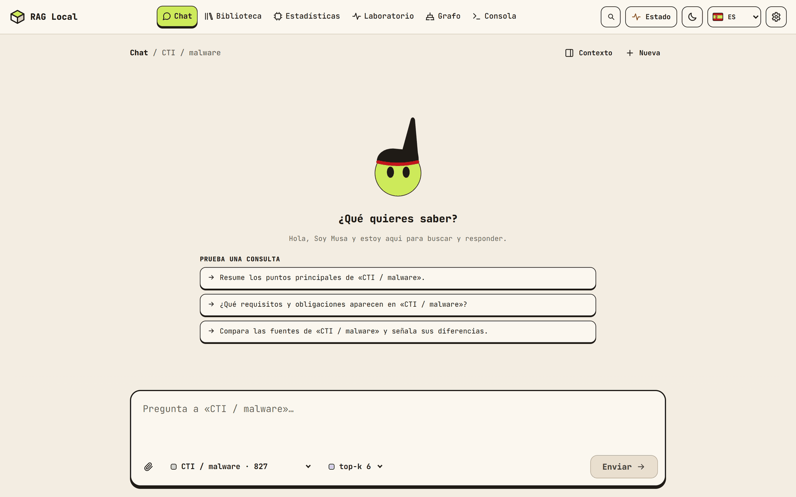
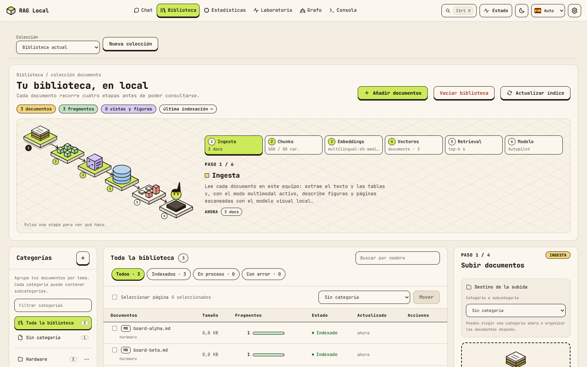
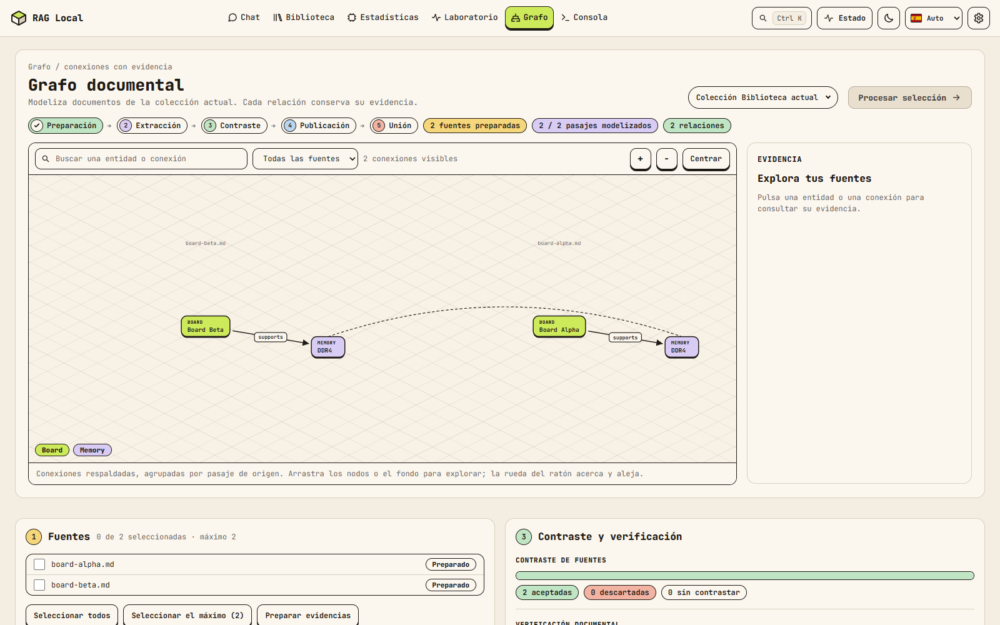
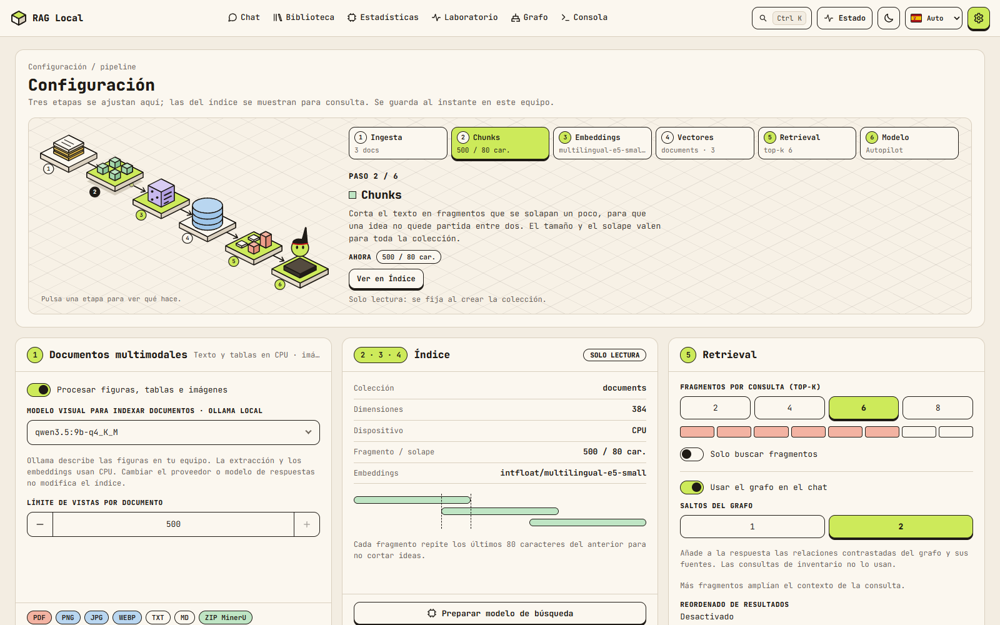
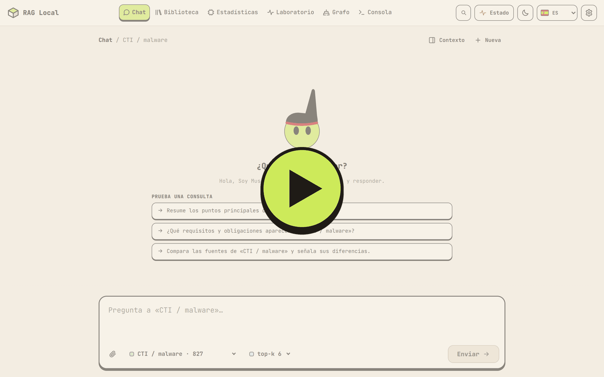

# RAG Local

[English](README.md) · **Español**

[](https://github.com/tunelko/rag-lab/actions/workflows/ci.yml)

Haz preguntas sobre tus propios documentos (PDF, texto, imágenes) desde una página
web en tu equipo. Los documentos se indexan en tu máquina y las respuestas citan su fuente.

## Chat



Pregunta con tus palabras. Musa responde con los documentos de la colección o categoría elegida en la caja de preguntar, y cada respuesta cita sus fuentes: **Contexto** abre los fragmentos que usó.

## Instalar

### Requisitos

1. **Sistema.** Windows x64 con PowerShell o Linux x86_64 con Bash.
2. **Python.** Instala **CPython 3.13.x de 64 bits**, con `venv` y `ensurepip`. El asistente crea sus entornos con pip e instala las bibliotecas de la aplicación. En Windows, comprueba la versión con `py -3.13 -V`. En Linux, usa `python3.13 -V` e instala `python3.13-venv` si tu distribución empaqueta ese módulo por separado. [Descargar Python](https://www.python.org/downloads/)
3. **Disco.** Elige una carpeta donde puedas escribir. Reserva espacio para el entorno Python, los modelos que elijas, tus documentos y su índice.
4. **Descarga inicial.** Necesitas conexión para obtener las dependencias y los modelos. Para copiar el proyecto con el comando de abajo, instala Git. También puedes descomprimir el ZIP del repositorio. [Descargar Git](https://git-scm.com/install/)
5. **Modelos.** Para generar respuestas locales necesitas Ollama en ejecución y un modelo descargado. Para analizar imágenes el modelo debe admitir visión. La búsqueda de texto usa embeddings en CPU. El perfil avanzado de PyTorch requiere una GPU NVIDIA y un controlador compatibles con su compilación CUDA 13.0. [Descargar Ollama](https://ollama.com/download)

**Compatibilidad de Python.** La instalación y la CI de Windows y Linux usan 3.13. De las dependencias fijadas, NumPy 2.5.4 requiere Python ≥3.12 y Transformers 5.22.2 requiere ≥3.11. Si ya utilizas 3.10 para otro proyecto, puedes instalar 3.13 en paralelo.

### Pasos

**1. Descargar el proyecto**

```text
git clone https://github.com/tunelko/rag-lab.git
cd rag-lab
```

**2. Descargar un modelo para respuestas locales**

```text
ollama pull qwen3.5:9b-q4_K_M
```

Con una GPU de 6 GB, puedes elegir en su lugar `ollama pull qwen3.5:4b-q4_K_M`. Esta variante acepta texto e imágenes y su descarga ocupa 3,3 GB. [Ficha de Qwen3.5 4B en Ollama](https://ollama.com/library/qwen3.5:4b-q4_K_M)

**3. Abrir el asistente de instalación**

```powershell
# Windows
powershell.exe -NoProfile -ExecutionPolicy Bypass -File .\install\windows\Configurar.ps1
```

```bash
# Linux
bash install/linux/configurar.sh
```

**4. Seguir el asistente**

1. **Idioma:** elige Español o English.
2. **Bienvenida:** revisa los requisitos y pulsa **Comprobar equipo** para ver qué se ha detectado.
3. **Entorno Python:** deja **Ollama GPU + embeddings CPU** y pulsa **Instalar dependencias**.
4. **Modelos Ollama:** pulsa **Actualizar modelos** y elige el modelo de texto. Para imágenes, activa multimodal y elige un modelo visual.
5. **Recuperación RAG:** deja los valores predeterminados.
6. **Revisar y guardar:** marca la confirmación y pulsa **Guardar configuración**.
7. **Listo:** pulsa **Iniciar web**.

## Usar

1. Abre **http://127.0.0.1:8765**.
2. En **Configuración**, pulsa **Preparar modelo de búsqueda**. Solo hace falta una vez.
3. En **Biblioteca**, pulsa **Subir e indexar** y espera a **Indexado**. Sigue el progreso en la franja del menú; púlsala para abrir **Estado del sistema** con los contadores de páginas y descripciones de imágenes.
4. En **Chat**, haz tu pregunta. **Contexto recuperado** muestra la fuente de la respuesta. Abre una fuente en el visor de documentos para leerla en una ventana modal o ampliarla a toda la aplicación; los PDF se abren en la página citada.

Para pedir un listado, elige la colección y, si procede, una categoría. «Enumera hasta 100 títulos del catálogo» consulta las fichas localmente. «Enumera hasta 100 proveedores mencionados en las actas» revisa los pasajes indexados de la selección con el modelo de respuesta. Musa elimina los nombres repetidos, aplica el límite y cita cada resultado. El ajuste de fragmentos por consulta (top-k) se usa para preguntas puntuales. Con un proveedor externo, los pasajes que requieren extracción se envían por lotes a ese proveedor. Ollama los procesa en el equipo.

Opcional: [preparar un corpus de recetas](tools/recipes/README.md) con un adaptador separado; el RAG general y la biblioteca activa se mantienen.

**Datasets CTI / APTs:** en **Biblioteca**, pulsa **Añadir CTI · APTs**, selecciona la nueva colección y pulsa **Sincronizar CTI · ATT&CK 20.1**. La muestra semántica predeterminada es de 5.000 documentos; las relaciones documentadas completas se guardan aparte en SQLite. Cambia de colección en Biblioteca para volver a tus documentos actuales. Las descargas, originales, evidencias Markdown, exportaciones JSONL y licencias quedan en `datasets/cti/`; los índices e históricos de cada colección, en `data/collections/`. El chat interpreta las preguntas estructuradas con el modelo configurado y cita la evidencia real; las técnicas de un grupo no establecen la secuencia de un incidente.

**Grafo (piloto):** abre **Grafo**, elige la colección, pulsa **Seleccionar el máximo** y después **Procesar selección**. La aplicación prepara las evidencias y el modelo extrae y contrasta las relaciones automáticamente; no necesitas revisar listas. El mapa muestra conexiones respaldadas con acceso a sus fuentes. Elige proveedor, modelo y documentos en esa pantalla; el envío remoto se selecciona expresamente. El proceso avanza un pasaje por turno con límites de cantidad, tiempo y memoria, y permite pausar y reanudar. Las identidades verificadas pueden ampliar las fuentes del chat enfocado; una ruta del grafo no demuestra por sí sola un hecho nuevo. Medición compara la recuperación normal y con grafo mediante JSONL anotado; no evalúa la veracidad de las respuestas generadas.

**Diagnóstico y registros** es opcional: incluye decisiones del modelo, revisión administrativa e informe por documento de integridad y duplicados exactos. El contraste automático no certifica la veracidad de todo el contenido.

## Arrancar y parar

Abre el panel desde la carpeta del proyecto para iniciar, parar o reiniciar el servidor. Muestra la dirección, el PID y las tareas activas. Cuando termina la cola se habilitan **Parar** y **Reiniciar**. **Salir** cierra el panel y deja el servidor en su estado actual.

| Acción | Windows | Linux |
|---|---|---|
| Abrir panel | `.\install\windows\Start-Web.ps1` | `bash install/linux/web.sh` |
| Arrancar | `.\install\windows\Start-Web.ps1 start` | `bash install/linux/web.sh start` |
| Parar | `.\install\windows\Start-Web.ps1 stop` | `bash install/linux/web.sh stop` |
| Reiniciar | `.\install\windows\Start-Web.ps1 restart` | `bash install/linux/web.sh restart` |
| Estado | `.\install\windows\Start-Web.ps1 status` | `bash install/linux/web.sh status` |

- **Otro puerto:** añade `-Port 8766` en Windows o `--port 8766` en Linux.
- **Otros equipos de tu red:** añade `-Host 192.168.1.20` en Windows o `--host 192.168.1.20` en Linux, con la dirección de este equipo. Quien pueda abrir la página comparte los mismos documentos; no hay cuentas.
- **Comprobar la instalación:** `.\install\windows\Configurar.ps1 -Check` o `bash install/linux/configurar.sh --check`.

## Tus datos

Todo queda dentro de la carpeta del proyecto y Git no sigue nada de ello.

| Ruta | Contenido |
|---|---|
| `data/` | Tus documentos, el índice y las preferencias de la web |
| `.env` | Configuración escrita por el asistente |
| `reports/` | Registros del servidor |

Las respuestas usan Ollama local salvo que elijas un proveedor en la nube en
**Configuración**; consulta [qué recibe un proveedor en la nube](docs/CLOUD_VISION.md).
La indexación es siempre local. Los límites de seguridad están en [SECURITY.md](SECURITY.md).
Las pruebas reales de seguridad y sus comandos están en [tests/README.md](tests/README.md).

## Biblioteca



Tus documentos y su estado. Pulsa **Añadir documentos** para subirlos; el dibujo muestra las seis etapas por las que pasa cada documento, de la ingesta al modelo, con la cifra actual de cada una. La tabla de abajo lista cada documento con sus fragmentos y si está **Indexado**.

## Grafo



Las conexiones encontradas entre las entidades que nombran tus documentos. Elige las fuentes, pulsa **Procesar selección** y sigue las cinco etapas de arriba. En el mapa, selecciona una tarjeta o una línea para leer en **Evidencia** el pasaje que la respalda.

## Configuración



Una tarjeta por etapa del flujo: qué se describe al indexar (**Documentos multimodales**), el índice en uso (**Índice**, solo lectura), cuántos fragmentos llegan al modelo (**Retrieval**) y, debajo, qué modelo responde (**Modelo**). Los cambios se guardan al instante.

## Vídeo

<a href="https://youtu.be/mW0idEUoc0Y"></a>

La aplicación en uso: [RAG system - A RAG proposal for search documents with open and cloud models](https://youtu.be/mW0idEUoc0Y). La imagen abre el vídeo en YouTube.
