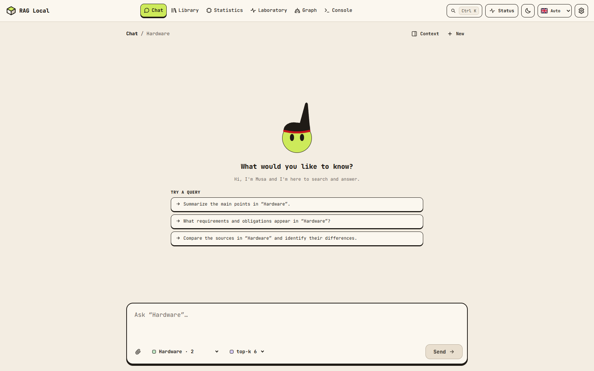
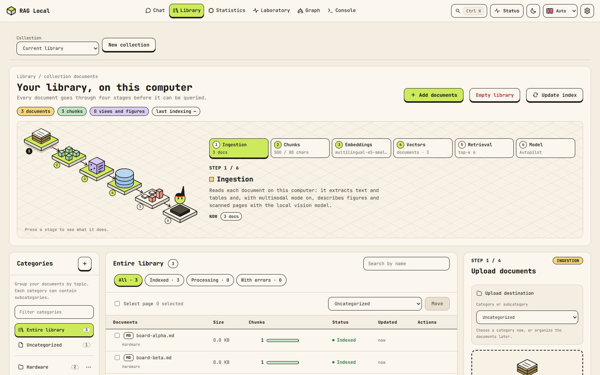
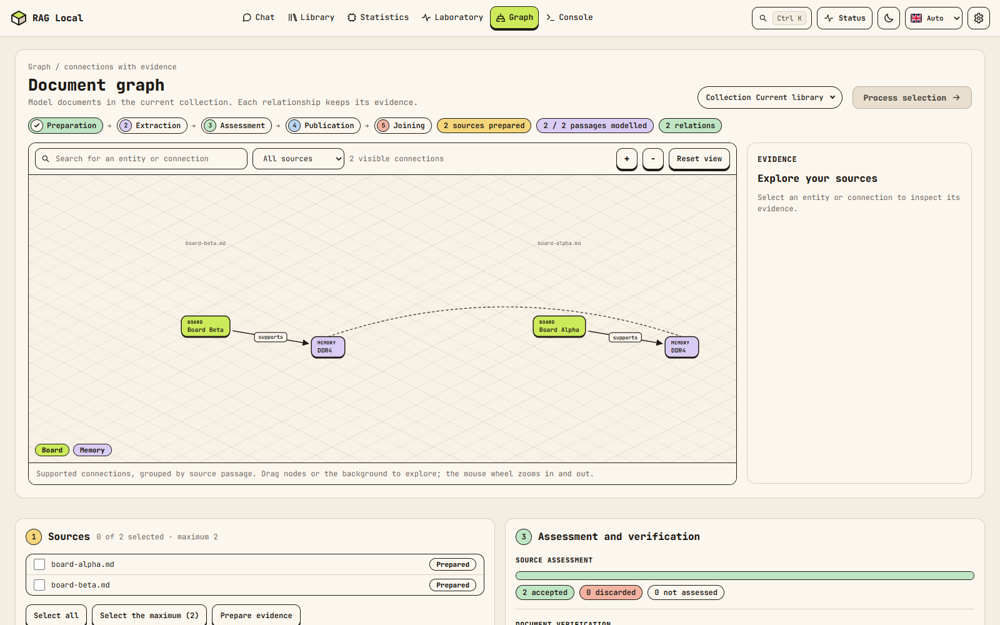
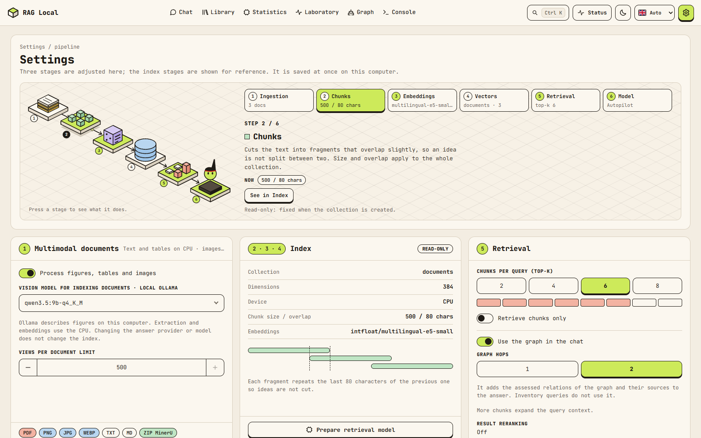
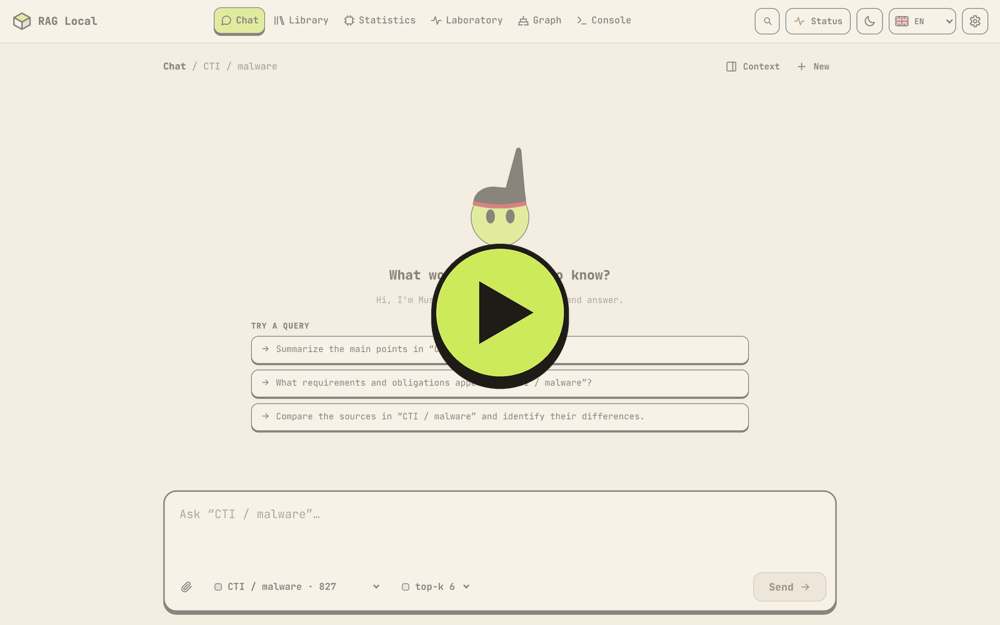

# RAG Local

**English** · [Español](README.es.md)

[](https://github.com/tunelko/rag-lab/actions/workflows/ci.yml)

Ask questions about your own documents (PDF, text, images) from a web page on your
computer. Documents are indexed on your machine and answers cite their source.

## Chat



Ask in your own words. Musa answers with the documents of the collection or category chosen in the question box, and every answer cites its sources: **Context** opens the fragments it used.

## Install

### Requirements

1. **System.** Windows x64 with PowerShell or x86_64 Linux with Bash.
2. **Python.** Install **64-bit CPython 3.13.x** with `venv` and `ensurepip`. The wizard creates its environments with pip and installs the application libraries. On Windows, check the version with `py -3.13 -V`. On Linux, use `python3.13 -V` and install `python3.13-venv` if your distribution packages it separately. [Download Python](https://www.python.org/downloads/)
3. **Disk.** Choose a writable project directory. Allow space for the Python environment, your chosen models, your documents and their index.
4. **Initial downloads.** You need internet access to download packages and models. Install Git to clone the project with the command below, or extract the repository ZIP. [Download Git](https://git-scm.com/install/)
5. **Models.** Local answers require a running Ollama server and a downloaded model. Image analysis requires a model with vision support. Text retrieval runs embeddings on the CPU. The advanced PyTorch profile requires an NVIDIA GPU and driver supported by its CUDA 13.0 build. [Download Ollama](https://ollama.com/download)

**Python compatibility.** The installer and the Windows and Linux CI use 3.13. Among the pinned dependencies, NumPy 2.5.4 requires Python ≥3.12 and Transformers 5.22.2 requires ≥3.11. You can install 3.13 alongside an existing 3.10 installation.

### Steps

**1. Download the project**

```text
git clone https://github.com/tunelko/rag-lab.git
cd rag-lab
```

**2. Download a model for local answers**

```text
ollama pull qwen3.5:9b-q4_K_M
```

With a 6 GB GPU, you can choose `ollama pull qwen3.5:4b-q4_K_M` instead. This variant accepts text and images and has a 3.3 GB download. [Qwen3.5 4B on Ollama](https://ollama.com/library/qwen3.5:4b-q4_K_M)

**3. Open the setup wizard**

```powershell
# Windows
powershell.exe -NoProfile -ExecutionPolicy Bypass -File .\install\windows\Configurar.ps1
```

```bash
# Linux
bash install/linux/configurar.sh
```

**4. Follow the wizard**

1. **Language:** choose English or Español.
2. **Welcome:** review the requirements and click **Check this computer** to see what the wizard detected.
3. **Python environment:** keep **Ollama GPU + CPU embeddings** and click **Install dependencies**.
4. **Ollama models:** click **Refresh models** and choose the text model. For images, enable multimodal and choose a vision model.
5. **RAG retrieval:** keep the defaults.
6. **Review and save:** tick the confirmation and click **Save configuration**.
7. **Done:** click **Start web**.

## Use

1. Open **http://127.0.0.1:8765**.
2. In **Settings**, click **Prepare retrieval model**. This is needed once.
3. In **Library**, click **Upload and index** and wait for **Indexed**. Follow progress in the menu strip; click it to open **System status** with page and image-description counts.
4. In **Chat**, ask your question. **Retrieved context** shows the source of the answer. Open a source in the document viewer to read it in a modal or expand it to the full app window; PDFs open on the cited page.

To request a list, select the collection and optionally a category. “List up to 100 catalog titles” reads the records locally. “List up to 100 suppliers mentioned in the minutes” checks indexed passages in the selection with the response model. Musa removes duplicate names, applies the limit and cites each result. The passage count (top-k) applies to focused questions. With a cloud provider, passages that require extraction are sent to that provider in batches. Ollama processes them locally.

With **Use the graph in the chat** enabled, ask “What do A and B have in common?” Name two modeled entities or two files in the collection. Musa checks the relationships against their sources. It can also compare passages from two indexed or graph-prepared documents using the configured response model. Each match cites evidence from both sides.

Optional: [prepare a recipe corpus](tools/recipes/README.md) with a separate adapter; the general document RAG and active library remain unchanged.

**CTI / APT datasets:** in **Library**, click **Add CTI · APTs**, select the new collection and click **Sync CTI · ATT&CK 20.1**. The default semantic sample is 5,000 documents; complete documented relationships are stored separately in SQLite. Switch collections in Library to return to your existing documents. Downloads, originals, Markdown evidence, JSONL exports and licenses are kept in `datasets/cti/`; collection indexes and history are in `data/collections/`. Chat uses the configured model to interpret structured questions and cites the actual evidence; a group's techniques do not establish an incident's sequence.

**Graph (pilot):** open **Graph**, choose a collection, click **Select the maximum** and then **Process selection**. The application prepares evidence and the model automatically extracts and assesses relationships; no list review is required. The map shows supported connections with access to their sources. Select provider, model and documents on that screen; remote transmission requires an explicit selection. Processing goes one passage at a time with passage, time and memory limits, and supports pause/resume. Verified identities can extend focused chat sources; a graph path alone does not prove a new fact. Measurement compares normal and graph retrieval using annotated JSONL; it does not grade the truth of generated answers.

**Diagnostics and logs** is optional: it includes model decisions, administrative overrides and a per-document integrity and exact-duplicate report. Automated assessment does not certify the truth of all content.

## Start and stop

Open the panel from the project folder to start, stop or restart the server. It shows the address, PID and active jobs. When the queue is empty, **Stop** and **Restart** become available. **Exit** closes the panel and leaves the server in its current state.

| Action | Windows | Linux |
|---|---|---|
| Open panel | `.\install\windows\Start-Web.ps1` | `bash install/linux/web.sh` |
| Start | `.\install\windows\Start-Web.ps1 start` | `bash install/linux/web.sh start` |
| Stop | `.\install\windows\Start-Web.ps1 stop` | `bash install/linux/web.sh stop` |
| Restart | `.\install\windows\Start-Web.ps1 restart` | `bash install/linux/web.sh restart` |
| Status | `.\install\windows\Start-Web.ps1 status` | `bash install/linux/web.sh status` |

- **Another port:** add `-Port 8766` on Windows or `--port 8766` on Linux.
- **Other devices on your network:** add `-Host 192.168.1.20` on Windows or `--host 192.168.1.20` on Linux, with the address of this computer. Everyone who can open the page shares the same documents; there are no accounts.
- **Check the installation:** `.\install\windows\Configurar.ps1 -Check` or `bash install/linux/configurar.sh --check`.

## Your data

Everything stays inside the project folder and none of it is tracked by Git.

| Path | Contents |
|---|---|
| `data/` | Your documents, the index and the web settings |
| `.env` | Configuration written by the wizard |
| `reports/` | Server logs |

Answers use local Ollama unless you choose a cloud provider in **Settings**; see
[what a cloud provider receives](docs/CLOUD_VISION.md). Indexing is always local.
Security boundaries are in [SECURITY.md](SECURITY.md).
Real security checks and commands are in [tests/README.md](tests/README.md).

## Library



Your documents and their state. Click **Add documents** to upload them; the diagram shows the six stages every document goes through, from ingestion to the model, with the figure of each one now. The table below lists every document with its chunks and whether it is **Indexed**.

## Graph



The connections found between the entities named in your documents. Choose the sources, click **Process selection** and follow the five stages at the top. On the map, select a card or a line to read the passage that supports it under **Evidence**.

## Settings



One card per stage of the pipeline: what is described when indexing (**Multimodal documents**), the index in use (**Index**, read-only), how many chunks reach the model (**Retrieval**) and, below, which model answers (**Model**). Changes are saved at once.

## Video

<a href="https://youtu.be/mW0idEUoc0Y"></a>

The application in use: [RAG system - A RAG proposal for search documents with open and cloud models](https://youtu.be/mW0idEUoc0Y). The image opens the video on YouTube.
