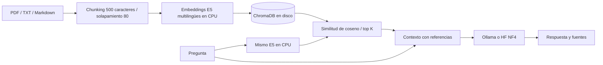

# Laboratorio RAG local para Windows y RTX 3080

Entorno instalado en `D:\problemas_gpu\rag-lab`, aislado del Python global y de OMP.
Python 3.13 x64, PyTorch 2.14.1 con CUDA 13.0, Transformers 5.22.2,
bitsandbytes 0.50.2, Accelerate 1.15.0, LangChain 1.4.9 y ChromaDB 1.5.9.
Las dependencias directas están fijadas; `requirements-lock.txt` registra todo el entorno.

## Interfaz web local: consulta y administración

Desde PowerShell, sin necesidad de activar el entorno:

```powershell
& 'D:\problemas_gpu\rag-lab\Start-Web.ps1'
```

Mantén esa consola abierta. Para cerrar el servidor, pulsa Ctrl+C.
Si el puerto está ocupado, usa `Start-Web.ps1 -Port 8766` y cambia el puerto de las URLs.

- Consulta: **http://127.0.0.1:8765/**
- Administración: **http://127.0.0.1:8765/admin**

La vista principal es Consulta. Permite elegir un modelo LOCAL instalado en Ollama,
preguntar, recibir el texto progresivamente y abrir las referencias `[1]`, `[2]`.
También permite buscar fragmentos sin generar una respuesta. Muestra tokens/s,
tokens de salida y tiempos a partir de las métricas nativas de Ollama al completar
la generación; durante la respuesta muestra el texto y el tiempo transcurrido.
No se estima la velocidad contando palabras o fragmentos HTTP.

Flujo inicial, completamente desde el navegador:

1. En Administración, selecciona o arrastra PDF, TXT o Markdown.
2. Pulsa **Subir e indexar**. La primera vez se descargan los embeddings y se cargan
   en CPU. La primera indexación tardará más por esa preparación.
3. Cuando termine, entra en Consulta, escribe una pregunta y pulsa **Preguntar**.
   Esa acción envía la solicitud a Ollama, que utiliza la GPU según su configuración.

El arranque del servidor no descarga modelos ni inicia inferencias. El botón
**Preparar modelo de búsqueda** permite adelantar la descarga CPU sin documentos.
**Actualizar índice** procesa archivos añadidos también desde el explorador de Windows.

La aplicación guarda los documentos en `data\documents`. Acepta hasta 20 archivos
por lote, 20 MB por archivo y 100 MB por lote. No sobrescribe archivos existentes:
si el contenido cambió, guarda una copia con otro nombre. Repetir el mismo nombre
y contenido no crea otra copia.

Consulta y Administración son vistas de una aplicación personal, NO cuentas o roles
autenticados. El servidor solo escucha en 127.0.0.1, valida Host/origen y exige un
token de sesión en peticiones de escritura. No se publica en Internet ni en la LAN.
Procesa una tarea a la vez para no solapar indexaciones y solicitudes de generación.

La UI se ha verificado con Edge en escritorio (1440x1080) y móvil (390x844).
El informe `reports\web-qa.json` distingue las pruebas simuladas de las inferencias
reales. Las capturas con respuestas contienen datos de prueba; no son benchmarks.

## Entrar al entorno

Desde PowerShell:

```powershell
Set-Location 'D:\problemas_gpu\rag-lab'
. .\Enter-Lab.ps1
python verify_env.py
```

La verificación predeterminada comprueba la disponibilidad de CUDA mediante NVML,
sin inicializar un contexto CUDA ni reservar tensores GPU. Importa las librerías y
prueba tensores CPU en otro proceso que tiene la GPU oculta.
No descarga ni ejecuta ningún LLM o modelo de embeddings.

Si la política de tu consola impide activar entornos, puedes usar directamente:

```powershell
.\.venv\Scripts\python.exe verify_env.py
```

Cuando hayas dejado libre la GPU, esta comprobación OPCIONAL ejecuta una pequeña
operación CUDA y una capa bitsandbytes NF4. No la ejecutamos durante la instalación:

```powershell
python verify_env.py --cuda-smoke --write-report
```

## Arquitectura



La ingesta y la recuperación usan CPU de manera predeterminada. La generación
solamente se ejecuta con `ask` sin `--preview`. No se inicia ningún servidor en
segundo plano ni se cambia la configuración de Ollama o de OMP.

### 1. Documentos e ingesta

Coloca PDF con texto, TXT UTF-8 y Markdown en `data\documents`, incluidos subdirectorios.
La primera ingesta necesita descargar explícitamente el modelo de embeddings:

```powershell
python rag.py ingest --download-embeddings
```

Se utiliza `intfloat/multilingual-e5-small` (384 dimensiones), con vectores normalizados
y los prefijos `passage: ` para documentos y `query: ` para preguntas, también en español.
Las cachés se guardan dentro de `.cache` en este proyecto de D:.
El modelo de embeddings se carga en CPU, con lotes de 16.
No se ha descargado durante la preparación del laboratorio.

Después, para actualizar el índice sin permitir nuevas descargas:

```powershell
python rag.py ingest
```

La ingesta compara SHA-256 y omite archivos sin cambios. Actualiza fragmentos de
archivos modificados sin duplicarlos y guarda documento, página y posición inicial.
Si cambias el modelo de embeddings o el chunking, usa otro `RAG_COLLECTION` en `.env`.
Los archivos retirados del directorio no se eliminan automáticamente del índice:
para reconstruir un corpus limpio, selecciona una colección nueva y reingesta.
Ejecuta una sola ingesta por colección a la vez.

Los PDF escaneados sin texto necesitan OCR, que no forma parte de esta instalación.
Los fragmentos son de 500 CARACTERES, no tokens. E5 limita su entrada a 512 tokens:
para textos con símbolos o caracteres muy densos, reduce el tamaño de fragmento.

### 2. Recuperación sin LLM

```powershell
python rag.py search '¿Qué especifica el documento sobre el procedimiento?' -k 4
python rag.py ask '¿Qué especifica el documento sobre el procedimiento?' --preview
```

`search` muestra textos, fuentes y distancia de coseno (menor significa más cercano).
`ask --preview` muestra el prompt aumentado y las referencias, sin llamar a un LLM.
El modelo de embeddings debe estar ya descargado en la caché.

### 3. Generación con Ollama

Esta fase sí envía una solicitud de inferencia a Ollama y usa la GPU según su configuración.
La configuración inicial apunta al BlackICE que ya estaba cargado. Cámbialo en `.env`
si prefieres otro modelo instalado. No se descarga ni selecciona otro automáticamente.

```powershell
python rag.py ask '¿Qué especifica el documento sobre el procedimiento?'
```

La salida incluye referencias `[1]`, `[2]`, las fuentes y tokens/s cuando Ollama los devuelve.
El cliente no fija `num_ctx`, no descarga modelos ni detiene procesos existentes.
Los valores de `RAG_CONTEXT_CHARS`, `RAG_TOP_K` y `RAG_MAX_NEW_TOKENS` limitan el prompt
y la respuesta. El número de caracteres no es una garantía del número de tokens del LLM.

### Alternativa: Transformers y bitsandbytes NF4

Este backend está preparado pero no se ha validado ejecutando un LLM en la GPU.
Primero deja VRAM suficiente y selecciona un modelo instruct compatible con Transformers,
preferiblemente 4B-8B. Un modelo GGUF de Ollama no se carga mediante bitsandbytes.

```powershell
# Para pesos ya presentes en disco o en la caché:
python rag.py ask 'Tu pregunta' --backend hf4bit --model 'D:\ruta\al\modelo'

# Solo para permitir explícitamente la descarga de un ID de Hugging Face:
python rag.py ask 'Tu pregunta' --backend hf4bit --model 'organizacion/modelo' --download-model
```

La carga usa NF4, doble cuantización, cálculo FP16 y pesos safetensors, sin código remoto.
Rechaza VRAM insuficiente y la descarga a CPU/disco del modelo. La comprobación de memoria
es preventiva: los pesos, las activaciones y el KV cache pueden seguir causando OOM según
el modelo y el contexto. No se carga ningún modelo HF durante la instalación.
Los 10 GB de VRAM son físicos; la memoria compartida de Windows no equivale a VRAM.

## Pruebas y reinstalación

```powershell
python -m unittest -v test_rag
python -m pip check
```

Las pruebas usan vectores falsos deterministas y no miden calidad semántica. Comprueban
lectura TXT/PDF, persistencia entre procesos, recuperación, deduplicación, actualización,
validación de configuración y referencias. Crean una base diminuta en `data\test-chroma`.
El informe de detección y librerías queda en `reports\verification.json`.

Pruebas de la web y del streaming, sin modelos reales:

```powershell
python -m unittest -v test_rag test_web test_ollama_stream
# Opcional: requiere requirements-dev.txt, Edge instalado y la web arrancada.
python qa_web.py
```

Para recrear las mismas versiones con Python 3.13 x64:

```powershell
.\Setup-Lab.ps1 -UseLock
```

No se instala CUDA Toolkit global, no se actualizan controladores y no se modifica
el Python global. Los wheels de PyTorch aportan el runtime CUDA necesario.

## Límites y próximos pasos

- Las fuentes permiten contrastar la respuesta; RAG no garantiza que el LLM sea correcto.
- Las instrucciones del prompt no eliminan por completo el riesgo de prompt injection en documentos.
- Falta validar recuperación y respuestas con tu propio corpus y preguntas con respuesta conocida.
- Un umbral de distancia, búsqueda híbrida y reranking deben calibrarse con esas preguntas,
  no añadirse con valores arbitrarios. El siguiente paso útil es una pequeña evaluación del corpus.
- Todo es local por defecto. Si cambias la URL de Ollama por un servidor remoto, le enviarás el contexto recuperado.

Documentación usada: [PyTorch](https://pytorch.org/get-started/previous-versions/),
[bitsandbytes](https://huggingface.co/docs/bitsandbytes/installation),
[LangChain + Chroma](https://docs.langchain.com/oss/python/integrations/vectorstores/chroma)
y [E5 multilingüe](https://huggingface.co/intfloat/multilingual-e5-small).
