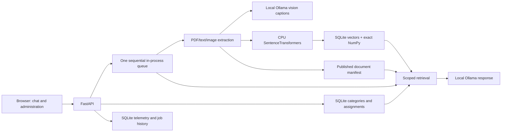

# Implementation audit — 2026-11-11

This review began at commit `8113dd5`; the findings below are reconciled with the
subsequent SQLite/NumPy storage and dependency remediation. Current storage and
upgrade instructions: [vector migration](VECTOR_MIGRATION.md), [evaluation](EVALUATION.md)
and [security status](../SECURITY.md).

This review covers the repository, isolated regression tests, local read-only
index integrity and GitHub dependency status. It distinguishes implemented
behavior from design limits. It is not a GPU benchmark, a manual evaluation of
every answer, or a certification that dependencies have no vulnerabilities.

## Architecture that exists

Categories have backend persistence and constrain retrieval. Calling this feature
“only an interface” was inaccurate. Each configured collection has a manifest,
an embedded vector collection and its own category database. Categories within
that collection share vectors; their file filter is applied before focused
nearest-neighbor selection. Query membership is captured when a request is
accepted. Moving a file between categories does not recalculate its embeddings.

This is logical document organization in a shared personal application. It is
not independent vector databases per category, a login system, or isolation
between users. Separate databases are not required for organizational filtering;
access control would require enforcement across every API and download route.

## Corrections from this audit

| Problem | Result | Regression evidence |
|---|---|---|
| Partial vector writes could enter focused/global evidence before manifest publication. | Both readers accept only IDs published in the manifest. | Failed-write and orphan-vector tests with real isolated SQLite. |
| Old vectors could be deleted before a failing manifest save. | Write new vectors, flush and replace the manifest, then collect obsolete vectors. Failed publication retains the old generation. | Simulated manifest failure and failed garbage collection. |
| CLI and web writers could race on one manifest. | A collection-scoped OS file lock excludes a second writer on Windows/Linux and releases on process exit. | A separate Python process attempts the same lock. |
| A document could change while parsing/writing its index. | Fingerprints are checked again before publication. | A loader changes its source during extraction. |
| Cancellation during vector staging could leave unnecessary staged records. | Explicit cancellation checks and best-effort cleanup preserve published data. | Cancel immediately after a vector write. A hard process crash can still leave invisible orphan vectors. |
| A multi-file API upload could index unrelated pending files. | The resulting index job receives exactly the saved batch filenames. | Upload two files with a third pending document outside that batch. |
| Queued jobs could silently adopt later settings. | Query and indexing preferences are captured at submission. | Hold a query in the queue, change the response model, then release it. |
| Category read/write races and stale file assignments. | Dependent changes use SQLite write transactions; a deleted external file no longer prevents deletion of an otherwise empty category. | Category API and persistence tests. |
| Filename and byte count could falsely confirm an interrupted upload. | Recovery requires a server-confirmed document ID/name. Unconfirmed entries remain retryable. | Browser tests use identical names/sizes with and without an acknowledgement. |
| Chat could adopt another tab's query or miss its own finished job. | Restore only acknowledged jobs belonging to stored turns; fetch finished jobs too. An unacknowledged turn becomes retryable without automatic resubmission. | Browser fixture with foreign, completed and unacknowledged jobs. |
| Runtime Ollama requests inherited proxies and followed redirects. | A shared direct transport disables ambient proxies and rejects redirects. Already-cancelled generation never contacts Ollama. | Two fake local HTTP services verify the selected endpoint is used and the second receives nothing. |
| Runtime model choices did not inspect the `remote_model` field. | Exclude that metadata as well as `remote_host` and cloud tags, matching the wizard's filter. | Fake Ollama metadata includes hidden remote models and mixed-case cloud tags. |
| Wizard discovery/startup assumed loopback and bypassed the lifecycle controller. | Managed state records the bind address; discovery checks it, and wizard startup uses the same background controller. | LAN discovery, existing-bind and real isolated lifecycle tests. |

These fixes do not require reindexing existing documents or changing Ollama,
GPU configuration, model weights or embedding policy. Manifest readers support
older records that do not yet contain the relative filename field.

## Checked against local runtime data

One read-only inspection found 19 documents and 20,894 published vector IDs.
The stored vector set matched exactly: zero missing IDs, zero unpublished IDs,
zero source-metadata mismatches and zero missing source files. All recorded PDF
page positions were within the originals' physical page counts. The manifest
hash was unchanged and the queue empty before and after inspection.

This checks structural integrity, not OCR accuracy, caption relevance, CPU
compatibility claims or answer factuality. No reindex or model inference was
needed for this inspection. Private filenames, documents and detailed reports
remain outside Git.

## Behavior verified and its boundary

| Area | Implemented and tested | Boundary |
|---|---|---|
| Library and retrieval | Durable category/subcategory assignments; exact scoped inventory; focused top-K; global per-document retrieval. | Global coverage means evidence from each file, not every page in the LLM prompt. |
| Multimodal ingestion | Text/tables, page/image assets, cached local captions, visual/text model routing. | Vector lines, borders and logos can still select pages for vision. |
| Chat/UI | Local Markdown sanitization, physical PDF page citations, source drawer, ES/EN, keyboard controls, responsive header. | Browser tests use known fixture answers, not a quality evaluation of real models. |
| Monitoring | Measured resource charts, console, query/index timings and seven-day SQLite history. | Missing readings are gaps; historical sensor data cannot be reconstructed. |
| Server lifecycle | Windows/Linux start, stop, restart, status, idle waiting, explicit private-LAN binding. | One API process; no distributed scheduler or durable execution queue. |
| Privacy/security | Embedded SQLite/NumPy, local models, source path checks, CSP, sanitized uploads/attachments, origin/token mutation checks, direct Ollama transport. | Trusted shared LAN, no accounts or per-user permissions; dependency status must still be monitored. |

## Remaining work, in priority order

1. **Dependency hygiene:** the 23 alerts present at the original audit were resolved
   by removing Chroma, pinning setuptools and publishing the real requirements graph;
   GitHub then reported zero open Dependabot alerts. This is a dated observation,
   not a guarantee that future advisories do not exist. Keep CI and the dependency
   graph active; see [SECURITY.md](../SECURITY.md).
2. **Multimodal cost:** production still uses the conservative image/drawing/text
   rule. The offline classifier in `visual_selection.py` has not replaced it.
   Label representative diagram, table and BIOS pages and measure figure recall
   before enabling a more selective policy. Existing view counts are not counts
   of unique useful figures. No measured 80% reduction has been established.
3. **Context planning and answer quality:** character limits are not exact token
   budgets. Focused text requests use Ollama's configured default context; global
   and visual requests set explicit context windows. Long history and multilingual
   evidence can exceed available space. A tokenizer-aware planner and corpus
   quality evaluations remain needed; increasing context blindly consumes VRAM.
   The local harness now measures dense/lexical/hybrid retrieval, but it needs a
   human-labeled corpus before it can justify a production change. See
   [retrieval behavior](RETRIEVAL.md) and [evaluation](EVALUATION.md).
4. **Crash recovery:** indexes and statistics persist, but execution jobs and
   their result payloads live in memory. A browser can recover its job while that
   server process remains alive; it cannot retrieve a lost result after a server
   restart. A process crash can leave unreferenced vectors consuming disk space;
   readers ignore them. No automatic destructive cleanup was added.
5. **Corpus management:** there is no document-delete/trash API or UI. Removing a
   queue entry or deleting an empty category does not delete a PDF. Existing
   manifests also contain absolute source paths; moving an already-built index
   between roots/operating systems requires reindexing or an explicit migration.
6. **Larger deployments:** serial ingestion competes with interactive queries.
   Exact search now reuses a resident normalized matrix and cached lexical features,
   but remains linear in vector count and global retrieval still represents every
   file. No production-scale latency, concurrency or memory bound
   has been established for thousands of PDFs. Additional API workers alone are
   unsupported. See the explicitly future [scaling roadmap](SCALING.md).

## Validation

Run the commands in [tests/README.md](../tests/README.md). Python tests exercise
temporary corpora, fake embeddings/models, direct fake HTTP services and real
isolated Uvicorn lifecycle workers. Browser acceptance covers uploads, cancellation,
settings, recovery, scoped chat, Markdown, PDF links, languages and layouts.
Frontend checks validate translations, identifiers, chart history and sensor
states. `pip check` verifies the installed dependency graph, not security.

CI repeats Python/frontend checks on Windows/Linux and browser acceptance on
Linux. Runtime integrity reports are private and are not CI fixtures. Passing
these checks must not be presented as proof that every real answer is correct.
