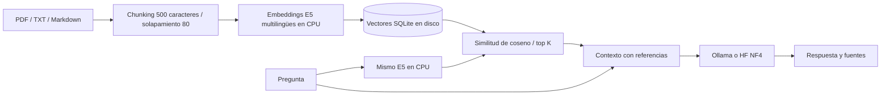

# RAG Local · Windows y Linux

[English](../README.md) · **Español**

[](https://github.com/tunelko/rag-lab/actions/workflows/ci.yml)

Consulta documental local con chat, fuentes verificables, PDF/figuras, SQLite/NumPy,
embeddings CPU y generación con Ollama. Incluye un asistente de terminal inspirado
en OMP: paneles divididos, navegación con teclado, selección de modelos, revisión
de cambios y registro de instalación. No necesita OMP ni Node.

## Empezar con el asistente

### 1. Instalar los requisitos

Requiere **Python 3.13 de 64 bits**, Git y Ollama. Se admiten Windows x64 y Linux
x86_64. Necesitas conexión para las descargas iniciales y espacio para paquetes,
modelos y documentos. Si ya están instalados, comprueba las versiones y pasa al
paso 2.

**Windows:** instala [Python 3.13 x64](https://www.python.org/downloads/windows/)
con el lanzador `py`, [Git](https://git-scm.com/install/windows) y
[Ollama](https://ollama.com/download/windows). Abre Ollama y una **ventana nueva de
PowerShell**. Comprueba:

```powershell
py -3.13 --version
git --version
ollama --version
```

**Linux:** instala Git, curl y Python 3.13 con soporte `venv` desde tu distribución.
Si no ofrece esa versión, este ejemplo para Ubuntu/Debian usa un Python gestionado
por [uv](https://docs.astral.sh/uv/guides/install-python/):

```bash
sudo apt update
sudo apt install -y git curl ca-certificates
curl -LsSf https://astral.sh/uv/install.sh | sh
. "$HOME/.local/bin/env"
uv python install 3.13
export RAG_SETUP_PYTHON="$(uv python find 3.13)"
```

Mantén esa terminal abierta o vuelve a exportar `RAG_SETUP_PYTHON` en una nueva si
Python 3.13 no está en PATH. Si lo instalaste desde tu distribución, comprueba
`python3.13 --version` y que dispone de `venv`.

Instala Ollama con su [instalador oficial para Linux](https://docs.ollama.com/linux):

```bash
curl -fsSL https://ollama.com/install.sh | sh
ollama --version
```

### 2. Descargar el proyecto

En PowerShell o en la terminal Linux:

```text
git clone https://github.com/tunelko/rag-lab.git
cd rag-lab
```

Conserva todos los archivos del proyecto juntos y ejecuta los pasos siguientes
desde esta carpeta `rag-lab`.

### 3. Preparar un modelo local

Comprueba `ollama list`. Si no conecta, abre Ollama o ejecuta `ollama serve` en
otra terminal; reutiliza la instancia si ya está abierta. El asistente muestra
los modelos instalados y no descarga LLMs por su cuenta.

Este ejemplo puede usarse tanto para texto como para visión:

```text
ollama pull qwen3.5:9b-q4_K_M
```

El comando descarga varios GB de pesos. Elige un modelo adecuado para tu memoria
y contexto; puedes usar otro modelo local instalado. Los modelos cloud se excluyen
y las imágenes requieren un modelo que declare capacidad de visión.

### 4. Abrir el asistente

**Windows — PowerShell:**

```powershell
.\Configurar.ps1
```

Si la política bloquea el script, esta alternativa se aplica solo a ese proceso:

```powershell
powershell.exe -NoProfile -ExecutionPolicy Bypass -File .\Configurar.ps1
```

**Linux:**

```bash
bash configurar.sh
```

El asistente usa un entorno separado en `.cache/wizard-venv`; el RAG usa `.venv`.
Tab / Shift+Tab cambian el foco, las flechas recorren opciones y Enter selecciona.
Ctrl+→ / Ctrl+← cambian de paso y Ctrl+Q sale. En terminales estrechas se oculta
el panel de ayuda.

### 5. Completar la configuración

| Pantalla | Qué hacer |
|---|---|
| **Bienvenida** | Comprueba Python, Ollama, entornos existentes y tareas activas. |
| **Entorno Python** | Elige **Ollama GPU + embeddings CPU**, pulsa **Instalar dependencias** y espera a que termine el registro inferior. |
| **Modelos Ollama** | Mantén `http://127.0.0.1:11434`, actualiza la lista y elige el modelo de texto. Activa multimodal y elige el visual para procesar imágenes; puede ser el mismo modelo compatible. |
| **Recuperación RAG** | Empieza por 4 fragmentos, colección `documents`, tamaño 500, solapamiento 80 y puerto 8765. |
| **Revisar y guardar** | Revisa los cambios, marca la confirmación y pulsa **Guardar configuración**. |
| **Listo** | Pulsa **Iniciar web** o usa los comandos del paso 6. |

El perfil recomendado instala PyTorch CPU para embeddings; Ollama gestiona por
su cuenta la GPU de generación. El perfil avanzado añade CUDA/HF y bitsandbytes,
y necesita un controlador NVIDIA compatible. El asistente no instala drivers.
Guarda `.env` y `data/settings.json`, con copias privadas en `.cache`.
Bloquea la instalación de paquetes mientras el servidor está abierto y el guardado
si hay trabajos activos. Conserva documentos, índices y modelos.

### 6. Iniciar la web

```powershell
# Windows
.\Configurar.ps1 -Start
```

```bash
# Linux
bash configurar.sh --start
```

Abre **http://127.0.0.1:8765** o la dirección que indique el lanzador. El servidor
queda en segundo plano; cerrar el navegador o la consola no lo detiene.

### 7. Probar con un documento pequeño

1. En **Configuración**, pulsa **Preparar modelo de búsqueda**; la primera vez
   descarga los embeddings multilingües que se ejecutan en CPU.
2. Crea un TXT con una frase verificable, por ejemplo «La copia se realiza cada viernes».
3. En **Biblioteca**, añade el fichero y pulsa **Subir e indexar**. Espera a **Indexado**.
4. En **Chat**, pregunta cuándo se realiza la copia.
5. Abre **Fuentes consultadas** y comprueba la referencia original.
6. Después prueba un PDF corto. Activa el modo multimodal y el modelo visual antes
   de indexar imágenes o páginas escaneadas.

La descripción de páginas usa inferencia y puede tardar varios segundos por página.
Las consultas esperan mientras se indexa un lote: comparten una cola secuencial.

Para comprobar el equipo sin modificar archivos ni instalar paquetes usa
`.\Configurar.ps1 -Check` o `bash configurar.sh --check`.

La [guía paso a paso](INSTALACION.md) explica cada pantalla y los requisitos.
[Preparación del repositorio](REPOSITORIO.md) describe las exclusiones y la
futura publicación. Documentos, modelos, índices y configuración privada no se
incluyen en Git. Repositorio: [tunelko/rag-lab](https://github.com/tunelko/rag-lab).
[Desarrollo, CI y diagnóstico](DESARROLLO.md) explica las comprobaciones automáticas.

La instalación de desarrollo original usa Python 3.13 x64, PyTorch 2.14.1 CUDA 13.0,
Transformers 5.22.2 y vectores SQLite con búsqueda NumPy. Las dependencias directas están fijadas;
`requirements/lock-windows-cu130.txt` conserva la instantánea histórica completa de Windows.

## Interfaz local: Chat, Biblioteca, Configuración y Estadísticas

Desde PowerShell, sin activar el entorno:

```powershell
.\Start-Web.ps1
```

Usa `Start-Web.ps1 status`, `stop` o `restart` para controlar el servidor.
Si el puerto está ocupado, usa `Start-Web.ps1 -Port 8766` y cambia el puerto de las URLs.

- **Chat:** http://127.0.0.1:8765/ — conversación sin estadísticas ni ajustes.
  Cada respuesta tiene **Fuentes consultadas**, plegado de entrada. Pulsar una cita
  abre sus fuentes. El historial de hasta 30 turnos se conserva en esta pestaña.
  Las respuestas se presentan como Markdown: títulos, listas, negrita, cursiva,
  tablas, citas y bloques de código con botón de copia. La copia de la respuesta
  completa conserva el Markdown original. Las citas `[1]` siguen abriendo sus fuentes;
  las citas escritas dentro de bloques de código se mantienen como texto.
- **Biblioteca:** http://127.0.0.1:8765/admin — subir e indexar documentos.
- **Configuración general:** http://127.0.0.1:8765/configuracion — selección automática/manual del modelo,
  2/4/6/8 fragmentos, búsqueda sin generación, procesamiento visual y sus límites.
  Un fragmento es un trozo del documento recuperado como evidencia para la pregunta.
  Los ajustes se guardan en `data/settings.json`, compartidos entre navegadores locales.
  **Guardar configuración** aplica los cambios a las consultas siguientes.
- **Estadísticas:** http://127.0.0.1:8765/estadisticas — biblioteca, servicios,
  tareas y tiempos/tokens de consultas recientes. Los datos de consultas se
  conservan en memoria del servidor, hasta 200 tareas; no representan un histórico
  permanente. Tokens/s proceden de las métricas nativas de Ollama, no de contar palabras.
  El tiempo de ejecución se separa de la espera en cola; al pasar el cursor por
  el tiempo se muestran embeddings, búsqueda, preparación de fuentes y generación.
  **Carga del equipo en tiempo real** añade lecturas cada 2 segundos de CPU, RAM,
  uso de GPU, VRAM, temperatura, potencia y consumo por proceso de RAG/Ollama.
  Las lecturas de GPU usan únicamente consultas de `nvidia-smi`; no cargan modelos
  ni cambian el modo de cómputo. Los valores no disponibles aparecen como «—».
  Las cuatro gráficas son compactas y permiten ampliar cada una con su botón de
  maximizar; Escape devuelve el tamaño normal. Hay ventanas de 1, 5 y 15 minutos,
  mínimos/media/máximos y detalle al pasar el cursor o usar las flechas. Pausar congela
  la visualización mientras continúa la recogida de lecturas. El historial es real,
  se conserva en memoria hasta 15 minutos y deja huecos si faltan datos de sensores.
- **Consola:** http://127.0.0.1:8765/?vista=consola — salida y actividad del servidor
  actualizada cada segundo. Incluye stdout, stderr, logs Python y avisos de procesado
  visual/caché. Permite pausar la visualización, buscar, filtrar por nivel, copiar,
  descargar y limpiar la vista. Es de lectura; no ejecuta comandos.
  Conserva las últimas 1000 líneas en memoria y limita la longitud de cada línea.
  Limpiar la vista no borra archivos ni el registro del servidor. Se consulta solo
  mientras está visible y se adapta también a móvil.
  El canal stderr no implica ERROR: los avisos y las barras de carga se clasifican
  por su contenido. Las horas con ≈ son horas de lectura de una salida recuperada,
  no la hora original demostrada del mensaje.

La captura integrada se inicia con el servidor. Para que una instancia anterior siga
indexando sin reiniciarla, `server_console_reader.py` lee los archivos fijos de salida
de ese proceso y sus fases reales mediante la API existente, y publica una instantánea
local para la misma sección. Finaliza cuando termina ese proceso o aparece el endpoint
integrado. Los mensajes de bibliotecas que se quedan en el búfer del proceso aparecen
al escribirse en el archivo; las fases se consultan cada segundo. Esta compatibilidad
no ejecuta inferencias ni modifica documentos, índices o preferencias.

### Primeros documentos

1. Revisa Configuración. Para procesar imágenes, activa el modo multimodal y elige
   un **modelo visual instalado** (por ejemplo `qwen3.5:9b-q4_K_M`, detectado localmente).
   Deja **Selección del modelo → Automática según la consulta** para que el chat
   elija entre el modelo de texto y el visual. También puedes elegir **Manual**.
2. En Biblioteca, añade PDF, TXT, Markdown, PNG/JPEG/WebP o un ZIP de exportación MinerU.
3. Pulsa **Subir e indexar**. Los embeddings usan CPU; su primera preparación puede
   descargar el modelo. Con el modo multimodal, las descripciones visuales se
   solicitan a Ollama durante esta acción y pueden utilizar la GPU.
4. En Chat, escribe la pregunta y pulsa **Enviar** o Ctrl+Enter.

El arranque y el guardado de ajustes no ejecutan inferencias ni descargan modelos.
Elige tus modelos instalados en el asistente o en Configuración. La selección
automática usa la pregunta y la evidencia recuperada para decidir entre el modelo
de texto y el visual. Comprobar capacidades no ejecuta inferencias.
**Preparar modelo de búsqueda**, en Configuración, adelanta la descarga de embeddings CPU.
No se instala MinerU completo ni se descarga ningún LLM automáticamente.

### Adaptación multimodal

Referencia conceptual: [artículo de Joaquín Videla](https://www.joaquinvidela.com/blog/multimodal-rag-base-documentos-figuras)
y [skrvidz/multimodal-rag-base](https://github.com/skrvidz/multimodal-rag-base).
Implementación propia sobre el laboratorio existente; no se ha copiado su aplicación.

### Selección de modelo por consulta

El modo **Automático** usa reglas locales, sin ejecutar un clasificador ni otra
inferencia. Primero recupera las fuentes y después elige:

- Pregunta textual con evidencia textual: modelo para consultas de texto. Una
  imagen incidental en la misma página no obliga a adjuntarla ni cambiar de modelo.
- Pregunta sobre una imagen, gráfico, diagrama, ubicación o color, con imágenes
  recuperadas: modelo visual. También se usa si la evidencia principal recuperada
  es una descripción visual, para inspeccionar su original.
- Una continuación breve puede conservar la intención visual de la pregunta anterior.
- Sin imágenes originales relacionadas, con el modo multimodal desactivado o con
  el modelo visual no disponible, usa el modelo de texto y registra el motivo.
- Una petición explícita de usar solo texto evita el cambio automático a visión.

Es una heurística y puede equivocarse. El modo **Manual** fija el modelo de respuesta;
un cliente API que envíe `model` explícitamente también fuerza ese modelo. No hay
descargas ni intentos con modelos alternativos arbitrarios. **Estadísticas** muestra
el modelo realmente usado y el motivo de selección, incluso en los casos de reserva.
La elección afecta solo a esta consulta y no exige reindexar. En 10 GB de VRAM,
alternar dos modelos puede implicar que Ollama descargue uno de VRAM y cargue el otro.

### Lectura, recuperación y respuesta visual

- **PDF:** PyMuPDF extrae texto y tablas en CPU. Las páginas con imágenes, gráficos
  vectoriales o sin texto se conservan como vistas completas de página. No se
  afirma detectar y recortar automáticamente cada figura de un PDF.
- **Imágenes:** se normalizan y reducen a 1440 px como máximo por lado. Ollama
  genera una descripción/transcripción que entra en el índice textual.
- **MinerU ZIP:** un único `*_content_list_v2.json` o `*_content_list.json`
  con sus imágenes relativas. El importador preserva texto, tablas y figuras,
  convierte páginas de base 0 a páginas de base 1 y rechaza rutas fuera del ZIP.
  No admite ZIP genéricos, extracción Office directa ni exportaciones solo Markdown.
- **Recuperación:** embeddings textuales en SQLite; las descripciones permiten
  encontrar imágenes, pero no hay embeddings visuales ni búsqueda por imagen.
- **Respuesta:** cuando la selección elige visión, el modelo recibe hasta el límite configurado de imágenes
  de las páginas recuperadas. Un modelo de texto recibe los fragmentos/descripciones.
  La presencia de una miniatura en Fuentes no significa por sí sola que el modelo
  haya visto sus píxeles: el modo real aparece en Estadísticas.
- Descripciones automáticas/OCR pueden contener errores. Revisa la imagen y el original
  al trabajar con cifras, diagramas o tablas complejas. La calidad y el ajuste en VRAM
  no se han medido con inferencias reales durante esta adaptación.
- Las páginas/figuras y sus descripciones se guardan en `data/visual`; la caché evita
  repetir descripciones idénticas con el mismo modelo/parser. El manifiesto del índice
  guarda referencias a figuras y la política de extracción.
- Límite predeterminado para nuevas configuraciones: 500 vistas/figuras por documento.
  Los ajustes guardados conservan su valor hasta cambiarlo en Configuración. El recuento
  se comprueba antes de solicitar descripciones a Ollama; si se supera, aparece el total
  necesario y no se confirma una indexación parcial. Las imágenes se procesan una a una:
  subir este límite amplía el trabajo total, no reserva VRAM para todas simultáneamente.
  Cambiar solo el límite conserva los documentos ya indexados, incluidos los manifiestos
  anteriores que almacenaban ese límite como parte de la política de extracción.
  Cambiar el modelo visual o activar/desactivar el modo requiere **Actualizar índice**.
  El CLI textual no sustituye un índice multimodal existente: usa la web para actualizarlo.

Los documentos originales quedan en `data/documents`. Se aceptan 20 archivos por
lote, 20 MB por archivo, dos subidas simultáneas y procesamiento secuencial.
Los ZIP admiten hasta 2000 entradas y 100 MB descomprimidos, sin enlaces simbólicos.
No se sobrescriben originales: los archivos cambiados se guardan con otro nombre.

El servidor escucha en 127.0.0.1, valida Host/origen y exige token CSRF para escrituras.
Es una aplicación personal con secciones, sin cuentas o roles autenticados. No se
publica en la LAN ni Internet. Documentos, imágenes, embeddings y consultas se
procesan en local; la primera descarga de dependencias/embeddings sí necesita Internet.
No se utiliza Claude ni Qdrant, Docker o un servicio externo de análisis documental.

La cola conserva progreso real, pausa, cancelación, reintentos y recuperación al
recargar. La cancelación visual es cooperativa: puede esperar a que Ollama entregue
el siguiente bloque. La escritura de lotes del índice no se interrumpe a mitad.
**Cancelar procesamiento**, en Biblioteca, detiene subidas, cancela los trabajos
en espera y solicita detener la extracción visual activa. Conserva originales y caché;
si ya se está escribiendo el índice, esa escritura termina antes de quedar inactivo.
Después de reiniciar el servidor, las tareas antiguas que ya no existen se muestran
como canceladas; sus archivos siguen disponibles para **Actualizar índice**.
El chat transmite al modelo los últimos tres pares de mensajes, acotados; recuperar
evidencia sigue basándose en la pregunta actual. No implementa las herramientas
iterativas del agente del repositorio de referencia.
Las llamadas de este RAG desactivan el thinking de Ollama para priorizar respuestas
visibles dentro del límite de salida. Las consultas con imágenes piden 8192 tokens
de contexto; se puede ajustar con `RAG_OLLAMA_VISION_CONTEXT` en `.env`. Son opciones
de cada petición del laboratorio, sin cambiar la configuración global de Ollama/OMP.
El historial transmitido se limita además a 6000 caracteres en total.

El informe `reports/redesign-qa.json` y sus capturas usan modelos y métricas
**simulados para probar la aplicación**, no son benchmarks de la RTX 3080.
La UI se comprueba en Edge a 1440 px y 390 px, sin peticiones externas del navegador.
Se mantienen los tokens y tipografías locales del paquete de rediseño.
El renderizado usa Marked 18.2.0 y DOMPurify 3.4.17, distribuidos localmente en
`dist/vendor` con licencias y hashes en `manifest.json`. No utiliza CDN ni necesita
npm para ejecutar la aplicación. Las distribuciones se verificaron con la integridad
SHA-512 del registro oficial antes de copiarlas. El módulo de DOMPurify conserva sus
bytes originales y se sirve con extensión `.js` para recibir el MIME JavaScript en Windows.
El HTML crudo se muestra como texto, los enlaces se limitan a esquemas permitidos y las
imágenes Markdown se presentan mediante su texto alternativo. Las figuras documentales
siguen disponibles en Fuentes. Así se evita cargar recursos remotos al leer una respuesta.

## Entrar al entorno

Los comandos de `verify_env.py` de esta sección corresponden al perfil avanzado
CUDA/HF. Para el perfil Ollama/CPU usa el diagnóstico del asistente (`-Check` /
`--check`) y `.venv` → `python -m pip check`; bitsandbytes no forma parte de ese perfil.

Desde PowerShell:

```powershell
# Desde la carpeta donde hayas clonado o descomprimido el proyecto:
. .\Enter-Lab.ps1
python verify_env.py
```

La verificación predeterminada comprueba la disponibilidad de CUDA mediante NVML,
sin inicializar un contexto CUDA ni reservar tensores GPU. Importa las librerías y
prueba tensores CPU en otro proceso que tiene la GPU oculta.
No descarga ni ejecuta ningún LLM o modelo de embeddings.

Si la política de tu consola impide activar entornos, puedes usar directamente:

```powershell
.\.venv\Scripts\python.exe verify_env.py
```

Cuando hayas dejado libre la GPU, esta comprobación OPCIONAL ejecuta una pequeña
operación CUDA y una capa bitsandbytes NF4. No la ejecutamos durante la instalación:

```powershell
python verify_env.py --cuda-smoke --write-report
```

## Arquitectura



La ingesta y la recuperación usan CPU de manera predeterminada. La generación
solamente se ejecuta con `ask` sin `--preview`. No se inicia ningún servidor en
segundo plano ni se cambia la configuración de Ollama o de OMP.

### 1. Documentos e ingesta

Coloca PDF con texto, TXT UTF-8 y Markdown en `data\documents`, incluidos subdirectorios.
La primera ingesta necesita descargar explícitamente el modelo de embeddings:

```powershell
python rag.py ingest --download-embeddings
```

Se utiliza `intfloat/multilingual-e5-small` (384 dimensiones), con vectores normalizados
y los prefijos `passage: ` para documentos y `query: ` para preguntas, también en español.
Las cachés se guardan dentro de `.cache` en este proyecto de D:.
El modelo de embeddings se carga en CPU, con lotes de 16.
No se ha descargado durante la preparación del laboratorio.

Después, para actualizar el índice sin permitir nuevas descargas:

```powershell
python rag.py ingest
```

La ingesta compara SHA-256 y omite archivos sin cambios. Actualiza fragmentos de
archivos modificados sin duplicarlos y guarda documento, página y posición inicial.
Si cambias el modelo de embeddings o el chunking, usa otro `RAG_COLLECTION` en `.env`.
Los archivos retirados del directorio no se eliminan automáticamente del índice:
para reconstruir un corpus limpio, selecciona una colección nueva y reingesta.
Ejecuta una sola ingesta por colección a la vez.

El CLI textual no realiza OCR de PDF escaneados. Usa la ingesta multimodal de la web
para describir sus páginas con el modelo visual local.
Los fragmentos son de 500 CARACTERES, no tokens. E5 limita su entrada a 512 tokens:
para textos con símbolos o caracteres muy densos, reduce el tamaño de fragmento.

### 2. Recuperación sin LLM

```powershell
python rag.py search '¿Qué especifica el documento sobre el procedimiento?' -k 4
python rag.py ask '¿Qué especifica el documento sobre el procedimiento?' --preview
```

`search` muestra textos, fuentes y distancia de coseno (menor significa más cercano).
`ask --preview` muestra el prompt aumentado y las referencias, sin llamar a un LLM.
El modelo de embeddings debe estar ya descargado en la caché.

### 3. Generación con Ollama

Esta fase sí envía una solicitud de inferencia a Ollama y usa la GPU según su configuración.
El CLI apunta al modelo configurado en `.env`. El asistente guarda el nombre del
modelo instalado que elijas. La selección automática según la pregunta se aplica a la web;
este comando CLI conserva su modelo fijo y no descarga otro automáticamente.

```powershell
python rag.py ask '¿Qué especifica el documento sobre el procedimiento?'
```

La salida incluye referencias `[1]`, `[2]`, las fuentes y tokens/s cuando Ollama los devuelve.
El cliente no fija `num_ctx`, no descarga modelos ni detiene procesos existentes.
Los valores de `RAG_CONTEXT_CHARS`, `RAG_TOP_K` y `RAG_MAX_NEW_TOKENS` limitan el prompt
y la respuesta. El número de caracteres no es una garantía del número de tokens del LLM.

### Alternativa: Transformers y bitsandbytes NF4

Este backend está preparado pero no se ha validado ejecutando un LLM en la GPU.
Primero deja VRAM suficiente y selecciona un modelo instruct compatible con Transformers,
preferiblemente 4B-8B. Un modelo GGUF de Ollama no se carga mediante bitsandbytes.

```powershell
# Para pesos ya presentes en disco o en la caché:
python rag.py ask 'Tu pregunta' --backend hf4bit --model 'D:\ruta\al\modelo'

# Solo para permitir explícitamente la descarga de un ID de Hugging Face:
python rag.py ask 'Tu pregunta' --backend hf4bit --model 'organizacion/modelo' --download-model
```

La carga usa NF4, doble cuantización, cálculo FP16 y pesos safetensors, sin código remoto.
Rechaza VRAM insuficiente y la descarga a CPU/disco del modelo. La comprobación de memoria
es preventiva: los pesos, las activaciones y el KV cache pueden seguir causando OOM según
el modelo y el contexto. No se carga ningún modelo HF durante la instalación.
Los 10 GB de VRAM son físicos; la memoria compartida de Windows no equivale a VRAM.

## Pruebas y reinstalación

GitHub Actions ejecuta la regresión Python (incluido el asistente) y las pruebas
de JavaScript en Windows/Linux con Python 3.13, Node 24 y PyTorch CPU. Linux añade
QA de navegador con Edge, corpus aislado y modelos simulados. Se ejecuta en cada
push/PR y puede lanzarse manualmente; no necesita tokens personales ni GPU.

```powershell
python -m unittest -v tests.unit.test_rag
python -m pip check
```

Las pruebas usan vectores falsos deterministas y no miden calidad semántica. Comprueban
lectura TXT/PDF, persistencia entre procesos, recuperación, deduplicación, actualización,
validación de configuración y referencias. Crean una base diminuta en `data\test-chroma`.
El informe de detección y librerías queda en `reports\verification.json`.

Pruebas de la web y del streaming, sin modelos reales:

```powershell
python -m unittest -v tests.unit.test_rag tests.unit.test_web tests.unit.test_ollama_stream tests.unit.test_redesign
# Requiere requirements/dev.txt y Edge; inicia y cierra su servidor de pruebas aislado.
python -m tests.browser.qa_redesign
# Solo lectura contra tu servidor ya iniciado:
python -m tests.browser.qa_web --url http://127.0.0.1:8765
```

Para recrear las mismas versiones con Python 3.13 x64:

```powershell
.\Setup-Lab.ps1 -UseLock
```

No se instala CUDA Toolkit global, no se actualizan controladores y no se modifica
el Python global. Los wheels de PyTorch aportan el runtime CUDA necesario.

## Laboratorio: comprobar la recuperación del chat

Abre **Laboratorio** en la barra superior. Primero debe haber documentos
indexados. Carga un JSONL UTF-8 (máximo 1 MiB y 100 preguntas) o pega su texto;
cada línea contiene una pregunta concreta, sus documentos/páginas de referencia
y, opcionalmente, un texto literal esperado en `evidence`.

**Validar conjunto** señala los errores por línea sin cargar modelos. **Evaluar
configuración del chat** captura K, presupuesto de evidencia y reordenador; no
cambia esos ajustes. La prueba usa una copia coherente del índice y no genera
respuestas ni llama a proveedores externos. El resultado principal es el número
de preguntas cuya evidencia aparece en el contexto, con su denominador. Las
preguntas sin evidencia anotada se muestran aparte.

Cada pregunta se puede desplegar para leer el contexto exacto. Puedes cancelar
desde esta sección, el aviso global o el diálogo **Vaciar biblioteca**. Se
termina la pregunta actual, se elimina la copia temporal y se conserva lo medido.
La página recupera los resultados al recargar; tras un reinicio un trabajo
incompleto aparece como interrumpido. Las fuentes modificadas no conservan
enlaces que puedan confundirse con el contenido medido.

La primera pantalla no ofrece comparaciones, historial navegable, exportación
ni evaluación de respuestas. [Diseño y formato JSONL](LABORATORY.md).

## Límites y próximos pasos

- Las fuentes permiten contrastar la respuesta; RAG no garantiza que el LLM sea correcto.
- Las instrucciones del prompt no eliminan por completo el riesgo de prompt injection en documentos.
- Falta validar recuperación y respuestas con tu propio corpus y preguntas con respuesta conocida.
- Un umbral de distancia, búsqueda híbrida y reranking deben calibrarse con esas preguntas,
  no añadirse con valores arbitrarios. El siguiente paso útil es una pequeña evaluación del corpus.
- Todo es local por defecto. Si cambias la URL de Ollama por un servidor remoto, le enviarás el contexto recuperado.

Documentación usada: [PyTorch](https://pytorch.org/get-started/previous-versions/),
[bitsandbytes](https://huggingface.co/docs/bitsandbytes/installation),
[SQLite](https://docs.python.org/3/library/sqlite3.html) y [NumPy](https://numpy.org/doc/stable/)
y [E5 multilingüe](https://huggingface.co/intfloat/multilingual-e5-small).
