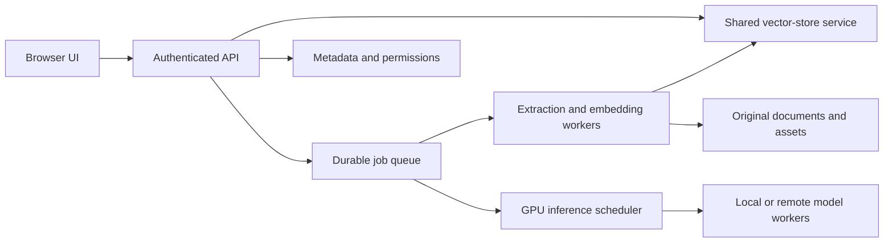

# Scaling roadmap

This is a plan for future work. The current supported deployment remains a
single-user local laboratory, with one API process, an in-process job queue, local
documents, embedded Chroma, SQLite statistics, CPU embeddings and Ollama generation.
The language selector and per-request response language do not make the service
multi-user or enable cloud deployment.

## 1. Measure and improve one machine

Use the existing seven-day telemetry and ingestion/query history to establish
queue wait, extraction time, caption calls, embedding throughput, first-token
latency, generation tokens/s, disk growth and peak RAM/VRAM. Measure several corpus
sizes and document types; a page with a diagram is not equivalent to plain text.
Record indexing and query latency separately.

First improve the measured bottleneck: batch CPU embeddings within a RAM budget,
reuse document fingerprints/caption caches, and validate visual-page selection
against labelled examples before reducing image analysis. Bound pending uploads,
queue depth, storage and request context. Adding web processes does not add GPU
memory or inference capacity.

The first scheduling improvement should separate ingestion from interactive work
and let captions yield at safe boundaries. Keep index publication atomic and
deduplicate retries. Do not promise simultaneous captioning and generation on a
10 GB GPU until a representative VRAM and latency test demonstrates it fits.

## 2. A shared server on the local network

Before permitting multiple users, add authentication, roles and document ownership.
Enforce permissions during retrieval, source/figure downloads, job access,
statistics, settings and console access; filtering only the final answer is too late.
Use separate public chat and privileged administration APIs. Replace the current
shared local session token with real user sessions, HTTPS and appropriate CSRF
controls. Define upload/storage quotas and retention policies per user.

Move jobs, cancellation state and result ownership to a durable shared queue/store.
Use leases, idempotent work items and explicit recovery after worker failure.
Move shared metadata/settings/history to a database designed for concurrent
services, and use a document store with tested backups and restore procedures.
Retain originals so indexes can be rebuilt and provenance remains verifiable.

Introduce a vector-store interface before selecting a shared deployment. Evaluate
a maintained server release or replacement on retrieval quality, metadata filters,
access control, Windows/Linux support, migration cost and measured performance.
The currently pinned Chroma server has unresolved advisories: do not expose it as
the shortcut to multi-user support. See [security status](../SECURITY.md).

## 3. Independent services and optional cloud infrastructure

After job state and permissions are shared safely, split services by resource:

Scale API/CPU workers separately from GPU workers. A scheduler must account for
model residency, VRAM, request context, backpressure and per-user fairness. Keep
one clear owner for each write operation. Replicating the current API process
would otherwise duplicate in-memory queues, model objects and background monitors.

Infrastructure may run on local servers or in the cloud. Cloud document/model
transfer must be an explicit deployment choice with defined privacy, cost and
retention rules. The local default must continue to work without cloud credentials.

## Release gates

Before declaring a stage supported, run concurrent-query/indexing tests with real
document mixes, bounded overload tests, interruption/retry tests, cross-user data
isolation tests and backup restore exercises. Publish p50/p95 latency, queue waits,
resource limits, corpus size and hardware. These are future validation criteria,
not performance guarantees for the current release.

References: [FastAPI deployment workers](https://fastapi.tiangolo.com/deployment/server-workers/)
and [Chroma deployment architecture](https://docs.trychroma.com/reference/architecture/overview).
Their available deployment modes do not replace this project's migration and
security requirements.
